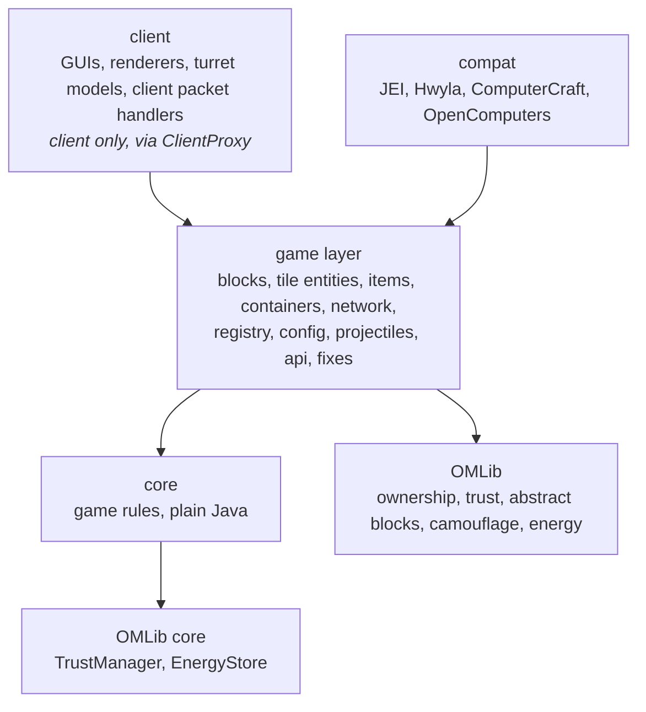

# Architecture

A guide to the code of Open Modular Turrets (OMT) on Minecraft 1.12.2 (branch `1.12`) for people working on it: how it is layered, what lives where, how the main flows run, and how to add the common things.
It describes the code as it is; where it falls short of its own rules, the last section says so.

The guide follows the one of the 1.20.1+ port (`docs/architecture.md` on branch `1.20.1+`): the `core/` and many class names are the same, rewritten for Java 8.
It has no Stonecutter build and no `platform/` layer, because 1.12.2 has one loader (Forge), and it uses MCP names (`TileEntity`, `Container`, `GuiContainer`) instead of Mojmap ones.
Building, running, releases and the rules for working on the code are in the workspace `CLAUDE.md` (OMTTeam 1.12 workspace).
The turret API for other mods has its own guide: [turret-api.md](turret-api.md).

OMT requires OMLib (`required-after:omlib`), which provides ownership and trust lists, the abstract block and tile entity classes, the camouflage menu, energy handling, the network validation and the config sync; see OMLib's `docs/architecture.md`.

## The idea in one paragraph

A **turret base** is the brain: it owns targeting, ammo, energy, upgrades, addons and the list of trusted players.
**Turrets** mounted on its six faces are thin: they aim at the target their base picked, keep their cooldown and fire.
All game rules (who is a target, how much a shot costs, what an upgrade does, who may change what) are plain Java in `core`, without any Minecraft class, so they are unit-tested in milliseconds.
The Minecraft-facing code around it translates between the game and the core and is kept as thin as possible.

## Layers

An arrow means "may use".
The other directions are forbidden and checked by the build (see [Rules the build checks](#rules-the-build-checks)):

- **core** uses only Java, itself and OMLib's `core`: no Minecraft, Forge, `com.mojang` or non-core packages.
- **common code** never uses **client** code: client classes do not exist on a dedicated server.
  Forge 1.12 dev environments have no separate client source set, so `client` is a package; common code reaches it only through the proxy (`@SidedProxy`: `CommonProxy`, `client.ClientProxy`) or `@SideOnly` methods.
- The mod class, `registry` and `handler` are on top and may use everything; nothing else imports the mod class or `registry` (registration only).
  `config`, `reference`, `sound` and `turret` are looked up from everywhere, so they import no blocks, items or tile entities.
- There are no `util` grab-bag packages: a helper goes next to what it serves.

### How core talks to the game

The core defines small interfaces for what it needs from the world; the game layer implements them.
This is the only place where the two meet, and the reason the core can be tested with fakes (`src/test/.../core/base/Fake*`).

| Core interface | Implemented by (game layer) | What it gives the core |
| --- | --- | --- |
| `core.world.BaseWorld` | `tileentity.base.TurretBaseWorld` | the base's position, its item slots, nearby entities, line of sight, solar check, warning a player |
| `core.item.ItemSlot` | `tileentity.base.ContainerItemSlot` (classified by `ItemClassifier`) | one inventory slot: count, what the item is (ammo, upgrade, addon, reactor fuel), extract |
| `core.target.TargetEntity` | `tileentity.base.LivingTargetEntity` | one living entity: position and eyes, health, armor, category, owner (pets), player info |
| `core.settings.LogicSettings` | `config.ConfigLogicSettings` | config values: turret stats, base tiers, entity lists, switches |
| OMLib `core.security.SecurityEnvironment` | `tileentity.base.OMTSecurityEnvironment` | scoreboard teams, operator rights, `turretsDamageTrustedPlayers` |

The tile entities own one core object each and forward to it: `TurretBase` → `core.base.TurretBaseLogic`, `TurretTileEntity` → `core.turret.TurretState`, `GeneratorTileEntity` → `core.generator.GeneratorLogic`.
The base's trust list is OMLib's `TrustManager`, which `TurretBaseLogic` gets from the base.

## Where things live

| Path | Contents | Shipped |
| --- | --- | --- |
| `src/main/java` | all code; client code in the `client` package | yes |
| `src/main/resources` | `assets/openmodularturrets` (models, blockstates, lang, textures, handwritten recipes), `mcmod.info` | yes |
| `src/api/java` | the ComputerCraft API, its own source set, compiled against and not packed | no |
| `src/test/java` | JUnit 5 tests of the core and the config, and the architecture rules | no |
| `src/test/resources/archunit_store` | the frozen architecture violations (a ratchet) | no |

Packages below `omtteam.openmodularturrets`:

| Package | Responsibility |
| --- | --- |
| (root) | `OpenModularTurrets` (the `@Mod`: start-up and the data fixers), `CommonProxy` |
| `core.base` | `TurretBaseLogic`: targeting per face, ammo, energy, upgrades, addons, redstone modes; `BaseTier`; `AmmoDraw`; `TurretPlacement` (what may be attached and stay) |
| `core.turret` | `TurretType` and `TurretTypes`, `AmmoType`, `TurretState` (cooldown, concealment, shot cost), aim and damage math (`TurretMath`, `RayMath`, `RayProfile`, `ProjectileMath`) |
| `core.target` | `TargetSelector`: who is a valid target and the best one; `TargetEntity`, `EntityCategory`, `TargetingPriority` |
| `core.security`, `core.card` | `DamageRules` (who turret damage may hit); `BaseCardRules` (the base part of the memory card copy rules) |
| `core.item`, `core.settings`, `core.world` | upgrade and addon types, the slot interface; stats and `LogicSettings`; the world interface, `Face`, `Neighbour` (turrets and inventory expanders), `Vector3`, `Box` |
| `core.storage` | `SlotCapacity`: how many stacks a slot holds with the base tier's stacks and the attached inventory expanders; `AmmoSort`: the order of the base GUI's "Sort Ammo" button (`TurretBaseInventory.sortAmmo`) |
| `core.generator` | `GeneratorLogic`: burning fuel, the energy multiplier upgrade |
| `api`, `api.weapon`, `api.tileentity` | the public turret API (`OMTPlugin`, `TurretDefinition`, `TurretRegistrar`, `AmmoDefinition`, `OMTApi`) and its weapons (`ProjectileWeapon`, `RayWeapon`, `EffectWeapon`, `AreaWeapon`, `SelfTargetingWeapon`); the built-in turrets use it too; the 3.x interfaces `ITurretBase`, `ITurretHead`, `ITurretBaseAddonTileEntity` |
| `turret` | `TurretRegistry`: turret and ammo definitions and the turret blocks, looked up by everything |
| `registry` | registration: `ModBlocks`, `ModItems`, `ModEntities`, `ModularTurretsTab`, `BuiltinTurrets`, `TurretLoader` (fills the turret registry in pre-init), `ModContainerScope` (registers a block as its mod) |
| `sound` | `ModSounds` (created before the turret definitions that use them) |
| `block.base`, `block.turret`, `block.misc` | the base (`BlockTurretBase`, tier in the metadata), the turrets (one `BlockTurret` class per type under the 3.x ids), the generator and the lever |
| `block.expander` | the inventory expanders (`BlockInventoryExpander`, one block per tier, facing and double plate in the metadata) and their item (`ItemBlockInventoryExpander`, stacks a second plate like a slab); it finds the machines by registry name, so it stays out of the package cycles |
| `tileentity.base` | `TurretBase` (the tile entity of the base) with `TurretBaseNbt`, `TurretBaseOverlay` (the Hwyla / The One Probe lines and who sees the disguise), and the adapters to core: `TurretBaseWorld`, `ContainerItemSlot`, `ItemClassifier`, `LivingTargetEntity`, `OMTSecurityEnvironment` |
| `tileentity.turret` | `TurretTileEntity` (the one tile entity of every turret), `TurretMount` (finding the turrets of a base and the bases of a turret), `RayWeapons`, `EffectWeapons`, `TurretOverlay` (the Hwyla / The One Probe lines; stats only for players who may open the base) |
| `tileentity.misc` | `GeneratorTileEntity`, `LeverTileEntity` |
| `entity.projectile` | the projectiles, `TurretDamage` (damage rules, hit tags, kill counting, the fake drops addon), `TurretImmunity`, `OMTFakePlayer` |
| `item`, `inventory`, `container` | items (ammo: the 3.x `AmmoMetaItem` and one `AmmoItem` per new ammo type, the crossbow bolt; upgrades, addons, intermediates, the memory card: `MemoryCardInteraction`, `MemoryCardNbt`); the base's slots and rules (`TurretBaseInventory`, `AmmoRules`; the ammo slots are OMLib large-stack slots); the container menus (OMLib `LargeStackContainer`s, the slot capacity synced as a window value) |
| `network` | `BasePackets` and `BasePacketHandler` (C2S requests of the base GUIs, always re-validated), `MessageTurretBase` and `MessageUpdateTurret` (S2C sync), `OMTNetworkingHandler` |
| `config` | `OMTConfig` (Forge `@Config`), `ConfigLogicSettings`, `ConfigMigration` (runs the `ConfigMigrationSteps` newer than the file's `general.configVersion`), `AddonTurretConfig` (stats of other mods' turrets), `DisposableAmmo`, `RecipeConfigFactory`, `ModuleEnabledConditionFactory` (recipe conditions) |
| `fixes` | `MissingIds` (renamed or removed ids), the data fixers `TENameFix`, `TurretTileEntityFix`, `GeneratorTileEntityFix` |
| `handler` | `OMTEventHandler` (loot, config, login), `OMTGuiHandler` (GUI ids) |
| `compat` | JEI, Hwyla (the lines come from `TurretBaseOverlay` / `TurretOverlay`, which the blocks also give The One Probe), ComputerCraft (`TurretBasePeripheral`), OpenComputers; `compat.computer.BaseComputerCommands` is what both computer mods share |
| `client` | `ClientProxy`, `ClientEventHandler`; `client.gui` (base, configure and generator screens), `client.model` (the 3.x turret models, the base's baked model), `client.render` (`TurretRenderer`, `TurretItemRenderer`, projectile renderers, the placement label), `client.network`, `client.api` (`OMTClientPlugin`, `TurretModelRegistrar`) |

`./gradlew dependencyMap` draws these packages and every import between them as an interactive page.

## How the main flows run

### Startup

`OpenModularTurrets.preInit`:

1. `TurretLoader.load(asmData, configDirectory)`: the built-in turrets (`registry.BuiltinTurrets`), then the plugins of other mods (the classes marked `@OMTPlugin.Register`, found in the ASM data).
   The turret types are frozen afterwards and the stats of other mods' turrets are loaded (`config/openmodularturrets_addon_turrets.cfg`).
   It runs before the registration events, because the turret blocks are created from the definitions.
2. `proxy.loadClientPlugins`, then `proxy.preInit()`: config, event handlers, networking (`OMTNetworkingHandler.initNetworking` gets the proxy's client handlers passed in, so common code does not reach into `client`), `ConfigSync` with a callback that rebuilds the parsed ammo list.
3. `ModCompatibility.preinit()` and the GUI handler.

Blocks and items are registered in `RegistryEvent.Register`; `init` registers the data fixers (data version 3: the 3.x tile entity ids, one turret tile entity, generator).
The client proxy adds renderers and models in `ModelRegistryEvent` and `ClientEventHandler`.

### A turret base tick (server)

`TurretBase.update` → `TurretBaseLogic.tick(gameTime)`:

1. Pending client updates and open-GUI syncs go out (`MessageTurretBase`); the neighbours are scanned once (`updateNeighbours`).
2. Solar panel and creative upgrade add energy; the redstone reactor every 20 ticks.
3. Targeting: for every face that has a turret with energy for a shot, the base looks for a target every few ticks (`TargetSelector`, with summed priorities and line of sight), or keeps checking the current one every tick.
   A target stays until it becomes invalid (dead, out of range, out of sight, now trusted).
4. Players about to be targeted get a warning; every 5 ticks: concealment, energy capacity and range limits.

Neighbour changes (a turret placed or broken) reach the logic through `updateNeighbours`, which hands it the turrets it found in its six neighbours.

### Placing a turret

`core.base.TurretPlacement` holds the rules: `canAttach` (placing: enabled, face, base tier, the tier's `maxTurrets`, the type's `maxSimultaneous`) and `canStay` (an attached turret: face and tier; `maxSimultaneous` only with `turrets.dropTurretsOverMaxSimultaneous`).
Both return a `Result` with the reason.
`ItemBlockTurret.placeBlockAt` first requires the placing player to be an admin of the base (`Result.NO_PERMISSION`), then calls `canAttach`.
The client draws the outline red or cyan (OMLib's `IDrawOutline.canPlace(…, EntityPlayer)`) and a small label for the reason (`client.render.TurretPlacementLabel`).

### A turret shot (server)

`TurretTileEntity.update`:

1. A turret without a base, or one that `TurretPlacement.canStay` rejects, drops itself.
2. Depending on the weapon of its definition: an `AreaWeapon` strikes what is in reach, a `SelfTargetingWeapon` picks its own targets, any other turns towards the target its base picked (`TurretMath`: yaw and pitch relative to the mounting face).
3. When the cooldown passed (`TurretState`), `beginShot` takes the base's energy and ammo.
4. The weapon does the rest: `ProjectileWeapon` spawns projectiles (lead and scatter from `ProjectileMath`), `RayWeapon` traces rays (`RayWeapons`), `EffectWeapon` acts directly (`EffectWeapons`).
5. Damage goes through `TurretDamage`, which applies the trust rules (`DamageRules`), kill counting and the fake drops addon.

The aim is synced to clients sparingly (`MessageUpdateTurret`, only when it changed); `TurretRenderer` interpolates it and draws the 3.x models in the mounting face's frame.

### A click in a GUI

Example: the player changes the range in the base screen.

1. `TurretBaseGui` (client) sends a C2S message (`BasePackets.SetRange`).
2. `BasePacketHandler` (server) schedules it on the server thread and finds the base through OMLib's `PacketValidation.find` (loaded, player within reach, of the type), then checks the player's access level for this action.
3. Only then does it change the logic (`TurretBaseLogic.setRange`), which marks the tile entity for saving and syncing.
4. The container and the tile entity sync bring the new state back to the screen.

The client is never trusted: every C2S handler re-checks distance and permission.

### Owners and claiming

The base and its turrets use OMLib's ownership: `TurretBase` extends `TileEntityOwnedBlock`, turrets connect through `IOwnedBlockAddon`, so claiming a base spreads over the turrets and the blocks around.
An unowned base does not fire unless `bases.unownedBasesActive` is set.
While a player holds the ownership wand, turrets still target them but nothing affects them (`TurretImmunity`, checked in `TurretDamage`, the effect weapons and, for explosions, `ExplosionEvent.Detonate`).
Looting is inverted as on 1.20.1+: turret kills drop nothing unless the base has the fake drops addon (`OMTEventHandler.lootEvent`).
Turret damage never knocks the victim back (`OMTEventHandler.knockBackEvent` cancels knockback by the turrets' fake player, the attacker of turret damage with a fake drops addon).
Grenade and rocket explosions (`TurretProjectile.explodeHere`) break blocks only with their `can…DestroyBlocks` config option; on `ExplosionEvent.Detonate` the projectile takes over vanilla's entity damage and push with a turret damage source (`TurretProjectile.affectByExplosion`).

### The generator

`GeneratorTileEntity` burns furnace fuel from its slots in order (`GeneratorLogic`), multiplied by the energy multiplier upgrade, and pushes energy into its neighbours as Forge Energy.
It has no owner and no trust list.

### Worlds from version 3.x

Registry names, metadata and namespaces stay as in 3.x, and the NBT keys stay readable (new code may write new keys but reads the old ones).
Renames go through Forge's tools: `fixes.MissingIds` remaps block and item ids (the Relativistic Turret becomes the Slowing Turret, the power generator the generator) and ignores removed ones (expanders, loot deleter); the `ModFixs` data fixers (`OpenModularTurrets.DATA_VERSION`) turn the per-turret tile entity ids into `openmodularturrets:turret` and the old generator into the new one.
Every change to ids, metadata, NBT or config keys is checked against the 3.x test worlds (`runenv/compat/compat-test.sh verify 3.1.14` and `verify 3.2.0` in the workspace).

## How to add …

### A turret

Through the turret API, even for built-in turrets: a `TurretType`, a weapon and default stats, registered in `registry.BuiltinTurrets` (or an `OMTPlugin` in another mod).
Then the model (client), assets, lang and recipes.
The full list is in [turret-api.md](turret-api.md).

### An upgrade or addon

Upgrades belong to one machine.
Add a constant to the machine's enum (`core.item.TurretBaseUpgradeType`, `AddonType` or `GeneratorUpgradeType`), register the item in `ModItems`, and implement the effect in the machine's logic; its slots accept only its own upgrades.
Give it a switch in `OMTConfig.ConfigUpgrades` or `ConfigAddons` (field and `isEnabled` case): a disabled one counts as not installed (`TurretBaseLogic.getUpgradeCount` / `getAddonCount` ask `LogicSettings.upgradeEnabled` / `addonEnabled`; another machine asks `item.ModuleToggles`), and its recipe JSONs need the condition `openmodularturrets:module_enabled` with the item's 1.20.1+ name in `"items"` (`config.ModuleEnabledConditionFactory`; `ModuleEnabledConditionFactoryTest` checks every upgrade and addon recipe).
The client marks disabled ones by itself: a red slot frame in the machine GUIs (`client.render.DisabledModuleOverlay`) and the barrier sprite over the icon in GUIs (`client.model.DisabledModuleModel`, a wrapper of the item models; 1.12 has no item decoration hook).

### A config value

Add a field to the `@Config` class in `config.OMTConfig`; expose it to the rules through `core.settings.LogicSettings` and `ConfigLogicSettings` if the core needs it.
Values that clients need are synced by OMLib's `ConfigSync`.
If you change a **default**, add a step to `config.ConfigMigration`.
The Forge config stays because of the 3.x config files.

### A packet

Define the message, register it in `OMTNetworkingHandler` and handle it in `BasePacketHandler`.
A C2S handler must start with OMLib's `PacketValidation` (schedule, find) and an access check.
An S2C handler goes into `client.network.ClientMessageHandlers`.

### A rule

Put it in `core` with a unit test first; the tile entity forwards.
Range, accuracy, fire rate, efficiency and scattershot formulas are not changed without asking the user.

### Recipes, loot, assets

No datagen on 1.12: recipes are handwritten JSON in `assets/openmodularturrets/recipes` with the config condition factory, loot is code.
Add the lang entries (`en_us` at least).
All art must be made by a human: use a placeholder and say which images are missing.

## Rules the build checks

`./gradlew check` fails when one of these is broken:

| Rule | Checked by |
| --- | --- |
| core uses only Java, core and OMLib core | `ArchitectureTest.coreDependsOnlyOnCoreAndJava` and the `verifyCoreIsolation` task |
| common code reaches `client` only through the proxy | `ArchitectureTest.commonCodeReachesClientCodeOnlyThroughTheProxy` (frozen in `src/test/resources/archunit_store`, empty now) |
| no new package cycles, and the known ones only shrink | `ArchitectureTest.noNewPackageCycles` (list `KNOWN_CYCLES`) |
| core rules behave as specified | unit tests in `src/test` |

There are no GameTests on 1.12: in-game behaviour is checked with the dev client and server in the workspace (`./gradlew :runenv:runServer -Pomcompat_action=boot` boots a server and stops it) and with the 3.x compatibility worlds.
`KNOWN_CYCLES` and the frozen store are ratchets; when the cycle test fails it prints the cycle, the class dependencies inside it (fewest first) and the updated list.
Never add to either without asking the user.

## Measuring code quality

| Tool | Command | Output |
| --- | --- | --- |
| Test coverage of `core` (JaCoCo) | part of `check`, which prints the line coverage per package | `build/reports/jacoco/test/html/index.html` |
| Mutation testing of `core` (PIT, on demand) | `./gradlew pitest` | `build/reports/pitest/index.html` |
| Dependency map | `./gradlew dependencyMap` | `build/reports/dependency-map/index.html` |

Run Gradle with a JDK 17+ in `JAVA_HOME`; the mod compiles and tests on the Java 8 toolchain.
Coverage says which lines the tests run; mutation testing says whether they check the results.
PIT plants small mistakes in core and runs the unit tests against each one; a survivor marks behaviour the tests do not pin down, unless the change cannot be noticed (an equivalent mutant).

## Known weak spots

Things that make the code harder to work with than they should be.
They are known, not hidden:

- **A package cycle around the turret API.** `api`, `api.tileentity`, `api.weapon`, `block.turret`, `entity.projectile`, `inventory`, `item`, `network`, `tileentity.base`, `tileentity.turret` and `turret` depend on each other in a loop: the API's weapons and `OMTApi` take `TurretBase` / `TurretTileEntity`, which use the weapons, projectiles, items and the definitions.
  The 3.x `api.tileentity` interfaces are only implemented, not used as types inside OMT; they could be kept, deprecated or removed (a decision for the user).
- **Two smaller cycles:** `block.misc` ↔ `tileentity.misc` (generator and lever), and in `core` (`core.base`, `core.item`, `core.settings`, `core.target`, `core.turret`, `core.world` reach each other, as on 1.20.1+).
- **`TurretBaseLogic` is large:** targeting, ammo, energy, upgrades, addons and warnings in one class.
  Candidates to move out are the ammo drawing and the energy generation.
- **Client code in the main source set.** The client rule is enforced by a test, not by the compiler.
- **Entities other mods add to the old target lists** (`MobBlockList`, …, removed with the 3.x `api.lists`) no longer affect targeting: the lists come from the config only.
- **The client is untested** except by hand; check GUIs, models and the aim on all six faces with `runClient` in the workspace.
