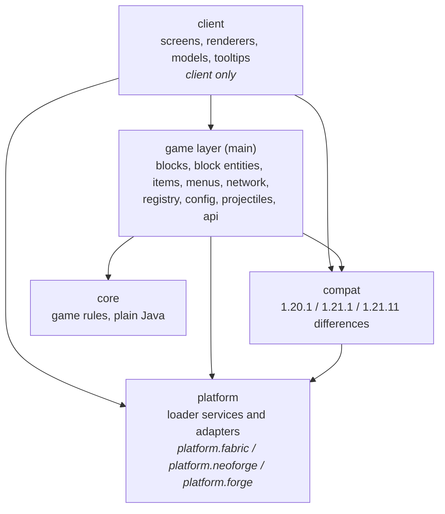

# Architecture

A guide to the code of Open Modular Turrets (OMT) for people working on it: how it is layered, what lives where, how the main flows run, and how to add the common things.
It describes the code as it is; where it falls short of its own rules, the last section says so.

**OMLib.** Since 2026-10-27 the code that both Open Modular mods used to share is in the library OMLib (git submodule `omlib`, bundled jar-in-jar): the platform layer, the compat helpers, energy and item transfer, the config machinery and the camouflage menu.
Where this document names those classes under `omtteam.openmodularturrets`, they are in `omtteam.omlib` with the same names and sub-packages; the README of OMLib lists them.

OMT is built for Fabric (1.20.1 and 1.21.1), NeoForge (1.21.1) and Forge (1.20.1) from one source tree.
Building, running and the Stonecutter commands are in the README, `CONTRIBUTING.md` and `CLAUDE.md` (section 4).
The turret API for other mods has its own guide: [turret-api.md](turret-api.md).

## The idea in one paragraph

A **turret base** is the brain: it owns targeting, ammo, energy, upgrades, addons and the list of trusted players.
**Turrets** mounted on its six faces are thin: they aim at the target their base picked, keep their cooldown and fire.
All game rules (who is a target, how much a shot costs, what an upgrade does, who may change what) are plain Java in `core`, without any Minecraft class, so they are unit-tested in milliseconds.
The Minecraft-facing code around it translates between the game and the core and is kept as thin as possible.

## Layers

An arrow means "may use".
The other directions are forbidden and checked by the build (see [Rules the build checks](#rules-the-build-checks)):

- **core** uses only Java and itself: no Minecraft, Fabric, NeoForge, Forge or other OMT packages.
- **main** code never uses **client** code: client classes do not exist on a dedicated server.
- Shared code uses only the `platform` interfaces, never `platform.fabric`, `platform.neoforge` or `platform.forge`: each of those is only compiled for its own loader.

### How the shared code talks to the loader

Two directions, so that gameplay code stays loader-free:

- Where the loader is in charge (registration, events, capabilities, client registrations), the loader entrypoint (`platform/<loader>/OMTFabric`, `OMTNeoForge`, `OMTForge`, and their client counterparts) calls shared code: `OMTStartup.registrationSteps()`, `InteractiveBlock.handleUse`, `ConfigSync.onPlayerJoin`, `KillCounter.onDeath`, `OMTClient.register…`.
- Where gameplay code must reach the loader, it calls a small service through `platform.Platform` (`LoaderInfo`, `Fuel`, `Network`, `Menus`, `Energy`; on the client `ClientPlatform` with `ClientNetwork`).
  Each entrypoint installs its implementations first thing; the `compat` facades (`NetworkCompat`, `MenuCompat`, `ClientNetworkCompat`) forward to them.

Energy and items other blocks may use are described loader-free (`core.energy.EnergyAccess`, `inventory.ItemAccess`, exposed by `getEnergyAccess(side)` / `getItemAccess(side)`) and wrapped by thin adapters per loader (Team Reborn Energy and Transfer API on Fabric, FE and item handler capabilities on NeoForge and Forge).

### How core talks to the game

The core defines small interfaces for what it needs from the world; the game layer implements them.
This is the only place where the two meet, and the reason the core can be tested with fakes (`src/test/.../core/base/Fake*`).

| Core interface (`core`) | Implemented by (game layer) | What it gives the core |
| --- | --- | --- |
| `world.BaseWorld` | `blockentity.base.BlockEntityBaseWorld` | the base's position, its item slots, nearby entities, line of sight, solar check |
| `item.ItemSlot` | `blockentity.base.ContainerItemSlot` | one inventory slot: count, what the item is (ammo, upgrade, addon, fuel), extract |
| `target.TargetEntity` | `blockentity.base.LivingTargetEntity` | one living entity: position and eyes (in the base's coordinates), health, armor, category, owner (pets) |
| `settings.LogicSettings` | `config.ConfigLogicSettings` | config values (turret stats, base tiers, entity lists) |
| `security.SecurityEnvironment` (OMLib) | `security.LevelSecurityEnvironment` (OMLib, with `OMTOwnershipSettings`) | scoreboard teams, operator rights |

All positions the core sees are in the base's coordinates.
On a Sable contraption these are the coordinates of its plot, far away from where the base is shown: `BlockEntityBaseWorld` converts entity positions into them with the base's `core.world.Pose` (from `compat.SubLevelCompat`), and converts the start of a line-of-sight check back into the world.
Outside contraptions the pose is `Pose.IDENTITY` and nothing is converted.

The block entities own one core object each and forward to it: `TurretBaseBlockEntity` → `core.base.TurretBaseLogic`, `TurretBlockEntity` → `core.turret.TurretState`, `GeneratorBlockEntity` → `core.generator.GeneratorLogic`.

## Where things live

Source sets (main and client split as with Loom's split source sets; the NeoForge and Forge builds have their own client source set too), plus the two test sets:

| Source set | Contents | Shipped |
| --- | --- | --- |
| `src/main` | everything that runs on both sides | yes |
| `src/client` | rendering, screens, client networking | yes, client only |
| `src/test` | JUnit tests of the core, config tests, architecture rules | no |
| `src/gametest` | game tests in a real server world, shared by Fabric, NeoForge and Forge (own test mod `openmodularturrets_gametest`) | no |

Packages below `omtteam.openmodularturrets` (main):

| Package | Responsibility |
| --- | --- |
| `OMT` | shared constants: `MOD_ID`, `LOGGER`, `OMT.id(path)` (depends on nothing of the mod but `VersionCompat`) |
| `startup` | shared start-up (`OMTStartup`: `init`, `registrationSteps`), called by the loader entrypoints |
| `core.base` | `TurretBaseLogic`: targeting per face, ammo, energy, upgrades, addons, redstone modes |
| `core.turret` | turret types and ammo types, `TurretState` (cooldown, concealment), aim and damage math (`TurretMath`, `RayMath`, `ProjectileMath`) |
| `core.target` | `TargetSelector`: who is a valid target and who is the best one |
| `core.security` | `DamageRules` (who turret damage may hit); the owner, trusted players and access levels (`TrustManager`) are in OMLib |
| `core.energy` | `EnergyStore` (the energy buffer of bases and the generator) and `EnergyAccess` (what other blocks may do with it) |
| `core.generator`, `core.camo`, `core.card` | generator burning, camouflage light rules, memory card copy rules |
| `core.item`, `core.settings`, `core.world` | upgrade/addon types, config value types, the world interfaces above |
| `core.storage` | `SlotCapacity`: how much an ammo or fuel slot holds with the attached inventory expanders |
| `api`, `api.weapon` | public turret API for other mods; the built-in turrets use it too |
| `registry` | registration of blocks, items, block entities, entities, menus, sounds, creative tab; `TurretRegistry` (turret definitions) |
| `block.*` | blocks: bases, turrets, defenses (hardened blocks, walls, fences, camo trap), lever, generator, inventory expanders |
| `blockentity.*` | block entities; `blockentity.base` holds the adapters to core |
| `entity.projectile` | turret projectiles and turret damage (`TurretDamage`) |
| `item`, `inventory`, `menu` | items (ammo, upgrades, addons, memory card; using the card on a block is `block.MemoryCardInteraction`), base inventory rules and `ItemAccess` (the slots other blocks may use, wrapped by the loader adapters), container menus |
| `network` | packets: client→server requests (always re-validated) and server→client sync (OMLib's `ConfigSync` sends the configs on join) |
| `config` | the JSON config: fields, comments, ranges, migration, the server's config on clients |
| `security`, `camo` | the mod's ownership rules (`OMTOwnershipSettings`); the trust lists' Minecraft side (NBT, player lookup) is in OMLib, and camouflage rules |
| `compat` | every 1.20.1 / 1.21.1 / 1.21.11 difference (`VersionCompat`, `CompatBlockEntity`, networking, menus; `compat.nbt.NbtCompat` for all NBT reads and `compat.block.BlockCompat` depend on Minecraft only, so any package may use them), small loader differences (`//? if fabric` / `neoforge` / `forge`), Jade (server half here, tooltips in `client.compat.jade`), and Sable contraptions (`SubLevelCompat`: poses and velocities through Sable Companion, 1.21.1 only; `client.compat.ClientSubLevelCompat` for the drawn pose) |
| `platform` | the loader services shared code calls (`Platform`: `LoaderInfo`, `Fuel`, `Network`, `Menus`, `Energy`); `platform.fabric` / `platform.neoforge` / `platform.forge` hold the entrypoints, the implementations and the energy/item adapters, and only compile for their loader |
| `datagen` | recipes, loot tables, tags, damage types (generated per version; Fabric only, the NeoForge build converts the 1.21.1 output and the Forge build the 1.20.1 output) |

`./gradlew dependencyMap` draws these packages and every import between them as an interactive page.

## How the main flows run

### Startup

The loader entrypoint (`OMTFabric`, `OMTNeoForge`, `OMTForge`) first installs the platform services, then calls `OMTStartup.init(plugins)` with the turret plugins of other mods it found.
The order matters:

1. `TurretRegistry.load(plugins)`: built-in turrets (`registry.BuiltinTurrets`), then the plugins (on Fabric the `openmodularturrets` entrypoints, on NeoForge and Forge the classes marked `@OMTPlugin.Register`, found by `NeoForgePlugins` / `ForgePlugins`).
   The turret types are frozen afterwards.
2. `OMTPackets.init()`: packet types (NeoForge accepts them only until its payload registration event).
3. `OMTConfig.init(addonTurretDefaults)`: needs the default stats of other mods' turrets (`TurretRegistry.addonDefaultStats()`); blocks need the config for their properties.

Then the registrations of `OMTStartup.registrationSteps()`: sounds, blocks, items, block entities, entities, creative tab, menus.
Fabric runs them in this order; NeoForge and Forge run each in the `RegisterEvent` of its registry (and fail at common setup if one never ran).
A registry class registers its content when it is loaded, so it must not be touched before its step; `ModSounds` is the exception (loading it only creates the sounds, which the turret definitions use in step 1).

Last, the entrypoint wires its loader to the shared code: the item and energy access of the `TransferHost` block entities (`ModBlockEntities.transferTypes()`: `FabricBlockLookups`, NeoForge capabilities, Forge capabilities attached in `AttachCapabilitiesEvent` by `ForgeBlockCapabilities`), block use (`InteractiveBlock.handleUse`), the config sync on join (`ConfigSync.onPlayerJoin`) and the kill counter (`KillCounter.onDeath`).

On the client, the loader client entrypoint (`OMTFabricClient`, `OMTNeoForgeClient`, `OMTForgeClient`; Forge 1.20.1 has no client-only `@Mod` classes, so `OMTForge` constructs it by name) installs the client platform services and calls `OMTClient.init(plugins)` (client packet handlers, ray packets, turret models, also from other mods).
It then registers what `OMTClient` lists with its loader: screens, model layers, block entity and entity renderers, item renderers, cutout blocks and tooltips, plus the camouflage models (`FabricCamoModel`, `NeoForgeCamoModel`, `ForgeCamoModel`) and the ray rendering.

### A turret base tick (server)

`TurretBaseBlockEntity.serverTick` → `TurretBaseLogic.tick(gameTime)`:

1. Solar panel and creative upgrade add energy.
2. Targeting: for every turret face that has energy for a shot, the base looks for a target every `targetSearchTicks` ticks (`TargetSelector`), or keeps checking the current one every tick.
   A target stays until it becomes invalid (dead, out of range, out of sight, now trusted).
3. Players about to be targeted get a warning.
4. Every 5 ticks: concealment, energy capacity and range limits; every 20 ticks the redstone reactor.

Neighbour changes (a turret placed or broken) reach the logic through `TurretBaseLogic.updateNeighbours`.

### Placing a turret (client and server)

`core.base.TurretPlacement` holds the rules: `canAttach` (placing: enabled, face, base tier, the tier's `maxTurrets`, the type's `maxSimultaneous`) and `canStay` (an attached turret: face and tier; `maxSimultaneous` only with `turrets.dropTurretsOverMaxSimultaneous`).
Both return a `Result` with the reason.
`TurretBlock.getStateForPlacement` first requires the placing player to be an admin of the base (`Result.NO_PERMISSION` otherwise; the client knows the trust list from the base's sync), then calls `canAttach` with the turrets it reads from the blocks around the base, so the client gets the same answer without the base's neighbour list (which only the server keeps).
The client's `TurretPlacementOutline` uses that to draw the cyan or red outline while a turret is held; when red, `TurretBlock.attachResult` gives the `Result`, shown as a small label (`message.openmodularturrets.placement.*`).

### A turret shot (server)

`TurretBlockEntity.serverTick`:

1. A turret without a base, or one that `TurretPlacement.canStay` rejects (lower tier, a face it may not use, optionally over `maxSimultaneous`), drops itself.
2. It asks its base for the target of its face and turns towards it (`TurretMath`, yaw and pitch relative to the mounting face).
3. `TurretState.beginShot` checks the cooldown, the base's energy and ammo, and takes them.
4. The weapon of the turret's definition does the rest: `ProjectileWeapon` spawns projectiles, `RayWeapon` traces rays (`RayWeapons`), `EffectWeapon` and `AreaWeapon` act directly (`EffectWeapons`), `SelfTargetingWeapon` picks its own targets.
5. Damage goes through `TurretDamage`, which applies the trust rules (`DamageRules`), kill counting and the fake drops addon.

The aim is synced to clients every few ticks; `TurretRenderer` interpolates it.

### A click in a GUI

Example: the player changes the range in the base screen.

1. `TurretBaseScreen` (client) sends a C2S packet (`network.BasePackets.SetRange`).
2. `BasePacketHandler` (server) finds the base through `PacketValidation` (loaded, player within reach) and checks the player's access level for this action.
3. Only then does it change the logic (`TurretBaseLogic.setRange`), which marks the block entity for saving and syncing.
4. The menu's container data and the block entity sync bring the new state back to the screen.

The client is never trusted: every C2S handler re-checks distance and permission.

### Owners and claiming

The ownership code is in OMLib; this mod provides the rules (`OMTOwnershipSettings`, read from the config) and the blocks.
Every block with an owner is an `OwnedHost` (OMLib): the turret bases and the camouflage trap through `TrustHost` (which forwards to its `TrustManager`), the passive defense blocks through `PassiveDefenseBlockEntity`, an `OwnedBlockEntity`.
A block placed without a player (machines, structures, `setblock`) or disowned has no owner; an unowned base does not fire unless `bases.unownedBasesActive` is set.
A main-hand right-click without sneaking on an unowned block (on a turret: its base) claims it (`ClaimInteraction`, an `InteractiveBlock` interceptor of the library, checked after the wand).
`block.ClaimSpread` then claims the unowned blocks connected to it through their faces (`core.world.FloodFill`, blocks whose `ClaimLink` connects claims, the turrets, join too; at most `bases.claimSpreadLimit` blocks, from `OMTOwnershipSettings`); blocks with an owner are never taken or walked through.
The loaders' fake players claim only if `general.fakePlayersCanClaim` is set.
While a player holds the wand, turrets still target them but nothing affects them (`TurretImmunity`, checked in `TurretDamage.canDamage`, the effect weapon dispatch and, for explosions, `LivingEntityMixin`).
Game masters set or remove owners with the `OwnershipWandItem` (`block.WandInteraction`, checked before claiming), spreading to the connected blocks of the same owner unless switched off.
The owner of a base or trap can give it up with the "Disown" button (configure screen, trap screen, `TrustPackets.Disown`), which clears owner and trust list; open menus of it close themselves through their `stillValid` checks.

### The generator

`GeneratorBlockEntity` burns furnace fuel from 9 slots in order (`GeneratorLogic`), multiplied by energy multiplier upgrades, and pushes energy into all six neighbours through the `Energy` service (Team Reborn Energy on Fabric, FE on NeoForge and Forge).
It has no owner and no trust list.

### Inventory expanders

`InventoryExpanderBlock` (tiers 1–3, no block entity, no inventory) enlarges the 9 ammo slots of a turret base and the 9 fuel slots of a generator next to it.
An expander is placed only against a turret base or generator (`InventoryExpanderBlock.isMachine`, checked in `getStateForPlacement`); a machine counts the plates of the expander next to each face, at most `SlotCapacity.MAX_STACKED` (2, one double block; `InventoryExpanderBlock.plateTiers`), and an expander counts for every machine next to it.
Two expanders of one tier fit into one block space like slabs (`DOUBLE`, the second plate stacked onto the first, placed by clicking the open side, `canBeReplaced`; it drops two): such a block counts as two plates.
A slot holds `itemMaxStackSize × base stacks × (1 + Σ stacks)`: a turret base's own stacks come from its tier (`bases.tier_N.baseAmmoStacks`, 2 on tiers 4 and 5, otherwise 1; a generator has 1), the stacks per expander tier from the config (`expanders.tier_N.stacks`, read on every check, so a changed config needs no rescan; `core.storage.SlotCapacity`); fuel that leaves a remainder (lava buckets) keeps its normal limit.
The base learns of its expanders through `Neighbour.Expanders` in `TurretBaseLogic.updateNeighbours`, the generator scans them itself, both on their neighbour updates.
The stacks above one stack are OMLib's large stacks: `TurretBaseInventory` and `FuelContainer` implement `LargeStackContainer` (also on the client, with the bonus stacks synced as menu data), the menus extend `LargeStackMenu` with `LargeStackSlot`s, the screens `LargeStackScreen`, and `VersionCompat.saveItems` saves the counts.
Removing an expander leaves larger stacks in the slots; they only cannot grow until they are below the new limit.

## How to add …

### A turret

Through the turret API, even for built-in turrets: a `TurretType`, a weapon and default stats, registered in `registry.BuiltinTurrets` (or an `OMTPlugin` in another mod).
Then the model (client), assets, lang and data.
The full list is in [turret-api.md](turret-api.md); a game test per turret belongs in `src/gametest`.

### An upgrade

Upgrades belong to one machine.
Add a constant to the machine's enum (`core.item.TurretBaseUpgradeType` or `GeneratorUpgradeType`), register the item in `ModItems` with the matching item class (`TurretBaseUpgradeItem`, `GeneratorUpgradeItem`), and implement the effect in the machine's logic.
A new machine gets its own enum and item subclass of `UpgradeItem`; its slots accept only those.

### A config value

Add a field to the right section of `config.ConfigData` with `@Comment` and `@Range`; the config file, its comments and the range check follow from them.
If you change a **default**, add a step to `config.ConfigMigrationSteps` (the version follows the last step), so existing files still on the old default get the new one.

### A packet

Define the payload (a record with `write`/`read`), register it in `network.OMTPackets` through `NetworkCompat`, and handle it in a `*PacketHandler`.
A C2S handler must start with `PacketValidation` and an access check.

### Code that differs between the Minecraft versions

The source is written for 1.21.1; Stonecutter comments switch it to 1.20.1 or 1.21.11.
Put the difference into a small helper in `compat` (for example `VersionCompat`) and call that, instead of `//? if` blocks in gameplay code.
Blocks with a block entity extend `compat.CompatEntityBlock`, which hides the block codec (pass a `BlockCodec` made with `codecOf`) and the pick block signature (override `pickItem`).
Block entities extend `compat.CompatBlockEntity`.
Right-click handling goes through `InteractiveBlock`, not vanilla's `use` methods.
NBT is only read through `compat.nbt.NbtCompat`, and the block, damage and registration differences of 1.21.11 are in `compat.block.BlockCompat` and `VersionCompat`.
A class that differs completely between versions goes into a version source folder instead of conditions: `src/<source set>/mc<first>-<last>/java` (`src/main/mc1.20.1-1.21.1`, `src/client/mc1.21.11-`, `src/gametest/mc1.21.11-`), with the same package and class name in each variant.
The 1.21.11 renderers, turret models and special item models, the transfer API adapters on NeoForge and the game test framework are such classes; Mojang renames that apply everywhere are Stonecutter replacements in `stonecutter.gradle.kts`.
The table of known differences is in `CLAUDE.md`, section 5.

### Code that differs between the loaders

The source is shared; Stonecutter also has a loader axis (nodes `1.20.1-fabric`, `1.20.1-forge`, `1.21.1-fabric`, `1.21.1-neoforge`, `1.21.11-fabric`, `1.21.11-neoforge`).

- A whole loader-specific class goes into `platform/fabric/`, `platform/neoforge/` or `platform/forge/` (also under `client/` and `gametest/`), which only compile for their loader.
- Gameplay code that needs the loader calls a service through `Platform`; a new service is a new component of `PlatformServices`, so every entrypoint must supply it.
- Something the loader drives (an event, a registration) is wired in both entrypoints to one shared handler or to content that shared code lists (`OMTClient` for the client).
- A small difference inside a shared class uses `//? if fabric {` / `//? if neoforge {` / `//? if forge {` (or `neoforge || forge` where both share an API, with imports per loader), but only in `compat/` and `platform/`.
- Fabric API and Team Reborn Energy may only appear in `platform/fabric/` and `datagen`: the NeoForge and Forge nodes do not compile anything else that uses them.
- Render types: NeoForge and Forge read `"render_type"` from the block model, Fabric registers the blocks `OMTClient.cutoutBlocks()` lists; keep both in sync.

### Recipes, loot tables, tags

Never handwrite files under `data/`: add them to the providers in `datagen` and run `./gradlew :1.21.1-fabric:runDatagen :1.20.1-fabric:runDatagen`.
The output is committed per version.
The NeoForge and Forge builds have no datagen of their own: they convert the Fabric output of the same Minecraft version (`convertFabricData` in `buildSrc`, Fabric load conditions become the loader's conditions).

## Rules the build checks

`./gradlew chiseledBuild` (or `check` for one node) fails when one of these is broken:

| Rule | Checked by |
| --- | --- |
| core uses only Java and core | `ArchitectureTest.coreDependsOnlyOnCoreAndJava` and the `verifyCoreIsolation` task (also forbids NeoForge and Forge) |
| shared code does not use Fabric API or Team Reborn Energy | compiling the `1.21.1-neoforge` and `1.20.1-forge` nodes |
| main code never uses client code | `ArchitectureTest.mainCodeNeverDependsOnClientCode` |
| no new package cycles, and the known ones only shrink | `ArchitectureTest.noNewPackageCycles` (list `KNOWN_CYCLES`) |
| core rules behave as specified | unit tests in `src/test` |
| every turret hits in a real world, on every loader | game tests in `src/gametest` (`runGameTest` on Fabric, `runGameTestServer` on NeoForge and Forge) |
| right-clicking a base opens its GUI for players with access only | `BaseGuiGameTests` |

The ArchUnit rules run on the Fabric nodes; they check the shared code, which is the same for NeoForge and Forge.
When the cycle test fails it prints the cycle, the class dependencies inside it (fewest first, the cheapest to cut) and the updated list.

## Measuring code quality

| Tool | Command | Output |
| --- | --- | --- |
| PMD: complexity, size, nesting, coupling (rules in `gradle/pmd/ruleset.xml`) | `./gradlew :1.21.1-fabric:pmdMain :1.21.1-fabric:pmdClient` (also part of `check`) | `versions/1.21.1-fabric/build/reports/pmd/main.html`, `client.html` |
| Test coverage of `core` and `api` (JaCoCo, unit and game tests) | part of `check`, which prints a summary per package | `versions/1.21.1-fabric/build/reports/jacoco/test/html/index.html` |
| Mutation testing of `core` (PIT) | `./gradlew :1.21.1-fabric:pitest` | `versions/1.21.1-fabric/build/reports/pitest/index.html` |
| Dependency map | `./gradlew dependencyMap` | `build/reports/dependency-map/index.html` |

PMD reports only for now; it does not fail the build.
Once the limits are agreed, switching off `isIgnoreFailures` in `build.fabric.gradle.kts` makes new code above them fail.
These tools run on the Fabric nodes only; code in `platform/neoforge` and `platform/forge` is covered by their game tests, not by coverage or mutation testing.

Coverage says which lines the tests run; mutation testing says whether they check the results.
PIT plants small mistakes in core (a flipped condition, `<` instead of `<=`, a removed call) and runs the unit tests against each one.
A mistake no test notices ("survived") marks behaviour the tests do not pin down, often an edge case or a missing save or sync call.
Not every survivor is a gap: where `>` and `>=` behave the same for every possible value, the change cannot be noticed.

## Known weak spots

Things that make the code harder to work with than it should be.
They are known and measured, not hidden:

- **A large package cycle.** 17 game-layer packages (registry, blocks, block entities, menus, network, inventory, api, projectiles) depend on each other in a loop, so none of them can be understood or changed in isolation.
  Typical for Minecraft mods (registry ↔ blocks ↔ block entities, and the turret API's weapons take the block entities); `noNewPackageCycles` and the dependency map list the cheapest links to cut.
  `OMT`, `config`, `security`, `item` and `camo` were taken out of it (start-up in `startup`, config sync in `network`, card use in `block`, camo menu opening in `menu`); `inventory` hangs on one link (`AmmoRules` → `TurretRegistry`).
  Three smaller cycles exist: in `core` (six packages around `core.base`), in `client` (`client.api` ↔ `client.model`), and between the `compat` facades and `platform` (the facades forward to the services, whose interfaces use the facades' types; accepted for the NeoForge port).
- **`TurretBaseLogic` is large** (about 700 lines): targeting, ammo, energy, upgrades, addons and warnings in one class.
  Candidates to move out are the ammo drawing and the energy generation.
- **29 PMD findings** above the complexity limits, mostly long methods with many branches (`RayWeapons.shoot`, `TargetSelector`, `TurretBaseScreen`, `ConfigWriter`).
- **Light block state properties on every base tier**: a deliberate memory trade-off, described in `CLAUDE.md` ("Known performance / memory trade-offs").
